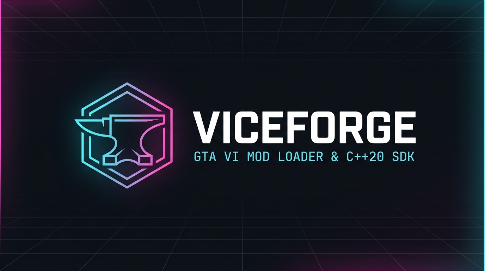

<div align="center">



# ViceForge

**Modular Forge-style mod loader, VFS overlay, C++20 SDK, and RAGE9 asset toolkit for *Grand Theft Auto VI*.**

[](https://github.com/PrivacyOnion/ViceForge/actions/workflows/ci.yml)


[Overview](#overview) •
[Features](#key-features) •
[Quickstart](#quickstart) •
[Writing a Mod](#writing-your-first-mod) •
[CLI Reference](#cli-reference) •
[Status Matrix](#status--capability-matrix) •
[Architecture](#project-layout)

</div>

---

## Overview

**ViceForge** provides the foundational modding infrastructure for RAGE9 titles before the target game executable (`game_scarlett_master.exe` / future desktop builds) is available.

Instead of hardcoding offsets, ViceForge separates **offline-complete core systems** (manifest resolution, SemVer dependency graph, VFS priority overlay, JOAAT-32 registries, prioritized event bus, native DLL loading, CLI tooling, and `RPF9`/`TTPF` inspection) from runtime game detours behind the [`IRuntimeBridge`](include/viceforge/runtime_bridge.hpp) interface.

```text
+-----------------------------------------------------------------------+
|                           User Mod DLLs                               |
|        include/viceforge/mod.hpp  +  VICEFORGE_DECLARE_MOD(...)       |
+-----------------------------------+-----------------------------------+
                                    |  Versioned C ABI (VfHostApi)
+-----------------------------------v-----------------------------------+
|                          viceforge_core.dll                           |
|   ModLoader  |  DAG Resolver  |  VfsMountTable  |  EventBus  | JOAAT  |
+-----------------------------------+-----------------------------------+
                                    |  IRuntimeBridge
             +----------------------+----------------------+
             v                                             v
   HeadlessRuntimeBridge                        GameRuntimeBridge (Next)
   CLI validation & CI tests                    VFS hooks, YSC natives,
   (runs today without .exe)                    D3D12 Present overlay
```

---

## Key Features

- **Versioned C ABI + Ergonomic C++20 SDK** (`abi.h`, `mod.hpp`): Clean `VfHostApi` callback table with `VICEFORGE_DECLARE_MOD` exporting `vf_mod_query`, `vf_mod_init`, `vf_mod_on_event`, and `vf_mod_shutdown`.
- **SemVer Manifest & DAG Load-Order Resolver** (`manifest.hpp`): Strict `viceforge.mod.json` parsing supporting `^`, `>=`, `=`, `*` constraints, optional dependencies, `conflicts`, `load_before` / `load_after`, and deterministic Kahn topological sorting with cycle detection.
- **VFS Path & Texture Hash-64 Overlay** (`vfs.hpp`): Case-insensitive normalized virtual RAGE9 paths (`common:/data/...`) and 64-bit `.ttpf` texture hash overrides with pinning (`pinned: true`) and explicit conflict tracking.
- **JOAAT-32 Registries** (`registry.hpp`): Case-insensitive & exact JOAAT-32 hashing, `namespace:path` `ResourceId`s, `DeferredRegister<T>` staging, collision rejection, and post-init freezing.
- **Prioritized Event Bus** (`events.hpp`): Priority tiers (`Highest` → `Lowest`) with cancellable events across `ModLoad`, `AssetMount`, `PreTick`, `PostTick`, `ScriptTick`, `DeviceCreate`, `Present`, and `Shutdown`.
- **RAGE9 Container Toolkit** (`rage9.hpp`): Read-only parsers for `RPF9` (`9FPR`) archive headers, `.ttpf` (`RDS5` / `ETPF`) chunk tables and DXGI formats, Xbox Series X / RDNA2 BCn block swizzle math, and `MicrosoftGame.Config` metadata.
- **Safe Win64 Proxy Bootstrapper** (`src/proxy_bootstrap.cpp`): Out-of-`DllMain` worker thread initialization (`viceforge_proxy.dll`) avoiding OS loader-lock deadlocks.

---

## Quickstart

### Prerequisites

- **Windows x64**
- **Visual Studio 2022** (MSVC C++20 toolset)
- **CMake ≥ 3.24** & **Ninja**

### Build & Run Tests

Open an **x64 Developer PowerShell for VS 2022** in the repository root:

```powershell
cmake --preset dev
cmake --build --preset dev
ctest --preset dev --output-on-failure -V
```

This builds `viceforge_core.dll`, `viceforge_proxy.dll`, `vfcli.exe`, `sample_mod.dll`, `sample_addon.dll`, and runs all 5 automated test suites (`test_manifest_resolver`, `test_vfs_registry`, `test_rage9_containers`, `test_mod_loader_e2e`, `test_cli_e2e`).

---

## Writing Your First Mod

Generate a ready-to-build mod skeleton with `vfcli`:

```powershell
.\out\build\dev\bin\vfcli.exe init my_handling_mod
```

### 1. Manifest (`viceforge.mod.json`)

```json
{
  "id": "my_handling_mod",
  "name": "My Handling Mod",
  "version": "1.0.0",
  "entry_dll": "my_handling_mod.dll",
  "dependencies": [
    { "id": "sample_mod", "version": ">=1.0.0" }
  ],
  "conflicts": [],
  "load_before": [],
  "load_after": [ "sample_mod" ],
  "asset_mounts": [
    {
      "virtual_path": "common:/data/handling.meta",
      "source": "assets/handling.meta"
    }
  ]
}
```

### 2. Entrypoint (`src/mod_main.cpp`)

```cpp
#include "viceforge/mod.hpp"

class MyHandlingMod final : public viceforge::Mod {
public:
    VfStatus on_init(const viceforge::ModContext& ctx) override {
        ctx.info("Loading custom vehicle handling rules");
        ctx.register_hash_override(0x1122334455667788ULL, "assets/custom_tire.dds");
        return VF_OK;
    }

    VfStatus on_event(const viceforge::ModContext& ctx, VfEventPayload& payload) override {
        if (payload.kind == VF_EVENT_PRE_TICK) {
            // Frame hook ready for ScriptTick / runtime updates
        }
        return VF_OK;
    }
};

VICEFORGE_DECLARE_MOD(MyHandlingMod, "my_handling_mod", "My Handling Mod", "1.0.0")
```

> Working two-mod dependency & VFS conflict-resolution examples live in [`examples/sample_mod`](examples/sample_mod) and [`examples/sample_addon`](examples/sample_addon).

---

## CLI Reference

| Command | Purpose | Example |
| --- | --- | --- |
| `vfcli init <mod-id> [--dir <path>]` | Scaffold a C++20 mod (`viceforge.mod.json`, `CMakeLists.txt`, `src/mod_main.cpp`) | `vfcli init tuning_pack` |
| `vfcli validate <mods-dir>` | Resolve dependency DAG, check constraints, and list VFS overrides/conflicts | `vfcli validate .\mods` |
| `vfcli run-headless <mods-dir>` | Load mod DLLs under `HeadlessRuntimeBridge` and simulate lifecycle events | `vfcli run-headless .\mods` |
| `vfcli inspect-rpf <file.rpf>` | Validate and display `RPF9` (`9FPR`) archive header metadata | `vfcli inspect-rpf .\common.rpf` |
| `vfcli inspect-ttpf <file.ttpf> [--hash <hex64>]` | Inspect `RDS5`/`ETPF` texture database and query a 64-bit texture hash | `vfcli inspect-ttpf .\ttdb_graphics.ttpf --hash 0x003AB1B4158C824D` |
| `vfcli inspect-package <game-dir>` | Parse `MicrosoftGame.Config` and report target executable presence | `vfcli inspect-package C:\Games\GTAVI` |
| `vfcli bench [--ttpf <file.ttpf>]` | Run hot-path throughput benchmarks (`EventBus`, `VfsMountTable`, `JOAAT`, `TtpfArchive`) | `vfcli bench --ttpf .\ttdb_graphics.ttpf` |

---

## Status & Capability Matrix

| Subsystem | Status | Works Today (No `.exe` Required) | Requires Game `.exe` |
| --- | :---: | --- | --- |
| Manifests & Dependency DAG | **Ready** | SemVer parsing, cycles, conflicts, load order | Build version string gating |
| C ABI & C++20 Mod SDK | **Ready** | Full headers, `VICEFORGE_DECLARE_MOD`, `ModContext` | Live world / player / entity host APIs |
| VFS Path & Hash-64 Overlay | **Ready** | Normalization, pinning, priority & conflict log | Runtime file & TTPF stream detours |
| Event Bus & Headless Host | **Ready** | Priorities, cancellation, `vfcli run-headless` | Live game tick, script tick & `Present` calls |
| JOAAT-32 `Registry<T>` | **Ready** | Collision checks, `DeferredRegister`, freeze | Injection into engine pools & managers |
| RAGE9 Toolkit (`RPF9`, `TTPF`) | **Ready** | Headers, `RDS5`/`ETPF` index, BCn swizzle math | Memory decryption keys & engine allocators |
| DLL Proxy Bootstrapper | **Skeleton** | Worker-thread loader outside `DllMain` | Export forwarding matching game imports |
| YSC Scripts & D3D12 Overlay | **Planned** | Interface contracts in `IRuntimeBridge` | Signature scan, native table & swapchain hook |

---

## Project Layout

```text
ViceForge/
├── cli/                  # vfcli developer & validation tool
├── docs/
│   ├── ARCHITECTURE.md   # ABI, lifecycle, VFS semantics, and RAGE9 internals
│   └── ROADMAP.md        # Pre-executable tooling to live runtime attachment milestones
├── examples/
│   ├── sample_mod/       # Base mod example (C++20 SDK + asset & hash64 override)
│   └── sample_addon/     # Dependent add-on testing load order & conflict precedence
├── include/viceforge/    # Public C ABI & C++20 SDK headers
├── src/                  # Core loader, VFS, manifest solver, RAGE9 readers, proxy bootstrap
└── tests/                # 5 automated C++20 test suites (CTest + GitHub Actions Windows CI)
```

- Detailed technical design: [`docs/ARCHITECTURE.md`](docs/ARCHITECTURE.md)
- Development milestones: [`docs/ROADMAP.md`](docs/ROADMAP.md)

---

## License

Licensed under the [MIT License](LICENSE). Copyright © 2026 PrivacyOnion.
